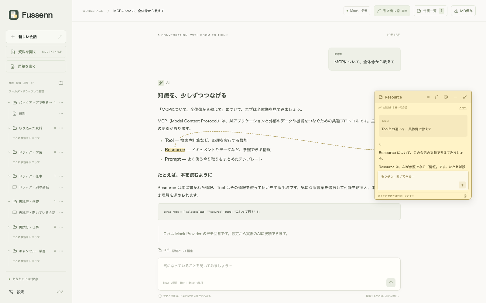
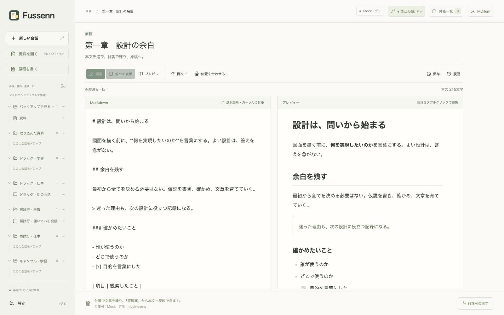

# Fussenn

**理解を、余白に。** 文章の一部に付箋を付け、AIと相談しながら読み書きするローカルアプリです。

旧名称「SideNote AI」から「Fussenn」へ名称を変更しました。既存データは移動せず、そのまま使えます。

AIの回答だけでなく、Markdown・テキスト・PDFの資料にも付箋を付けられます。原稿では、付箋で練った文章を差分を確認して本文へ反映し、履歴から元に戻せます。



## できること

- **文脈付きの付箋**：選択した文章についてメモ・AIへの質問。色、移動、折りたたみ、曲線の調整、一覧表示。
- **資料を読む**：Markdown・テキスト・テキスト入りPDFの取り込み。本文はFussenn内にコピーして保存。OCRは対象外。
- **原稿を書く**：直接編集、Markdownプレビュー、目次、文字数、AI原稿案の置換・挿入、履歴の復元。
- **整理して持ち出す**：会話のフォルダ整理、Obsidian向け相互リンク付きMarkdown、全体バックアップと復元。
- **AIの接続を選ぶ**：Codex / ChatGPT、OpenAI API、OpenAI互換サーバー、操作確認用Mock。



## まずローカルで試す

Node.js **22.13以上**とnpmが必要です。開発・Windows/Mac検証の基準はNode.js **24.22.2**です。

```sh
npm run setup
```

固定した依存をインストールし、SQLiteとビルドツールの起動を確認します。SQLiteは同梱バイナリを使います。セットアップの背景は [開発への参加](CONTRIBUTING.md#セットアップの仕組み) を参照してください。

`.env.example` を `.env.local` にコピーします。

```powershell
# Windows / PowerShell
Copy-Item .env.example .env.local
```

```sh
# macOS / Linux
cp .env.example .env.local
```

外部AIを使わず操作を試すには、`.env.local` の設定を変更します。

```dotenv
ENABLE_MOCK_PROVIDER=true
```

```sh
npm run dev
```

[http://127.0.0.1:3000](http://127.0.0.1:3000) を開き、Providerに **Mock** を選びます。Mockは固定のデモ回答で、APIキーやログインは不要です。

本番相当のローカル起動は `npm run build` の後に `npm start`。各AIの接続方法や詳しい操作は [使い方](docs/usage.md) を参照してください。

## 専用アプリとして使う

Electronの専用ウィンドウで利用できます。ソースからの起動は次の順です。

```sh
npm run desktop:prepare
npm run desktop
```

| 環境 | 状況 |
| --- | --- |
| Windows x64 | 名称変更後、GitHub Actionsでビルド・ブラウザ版テスト・配布版テストと、検証専用インストーラーでの導入・更新・削除を確認（配布用EXEを実機で手動インストールした確認は旧名称時）。インストーラーには署名しない（[起動時の警告](docs/desktop.md#windowsで使う)）。 |
| macOS Apple Silicon | 名称変更後もDMG・ZIP生成と配布版テストを確認済み（ローカルとGitHub Actions。実機操作の確認は旧名称時）。Developer IDによる署名と公証は、指定したローカルのビルドで、アプリとDMGの両方について確認済み。CIの成果物は未署名・未公証。 |
| macOS Intel | GitHub ActionsのIntel Macと、Apple Silicon上のRosetta 2で、ビルドと配布版テストを確認。画面を使った実機操作、署名したIntel版の確認、公証は未実施。 |
| Linux | GitHub Actions（Ubuntu 24.04）で、ブラウザ版テスト、デスクトップ版のビルドと展開したアプリでの配布版テスト、AppImage生成を確認。AppImageからの起動と実機での確認は未実施。 |

GitHubでの一般公開・リリース配布はまだ行っていません。アプリの生成方法と確認範囲は [デスクトップ版](docs/desktop.md)、Macの実機確認と署名の制限は [Macの検証記録](docs/mac-validation.md) を参照してください。生成したデスクトップ版にはNode.jsを同梱します。Codex Providerを使う場合は、Codex CLIとChatGPTログインが別途必要です。

## 保存とプライバシー

会話・資料の本文・原稿・付箋は、新規利用では **`~/.fussenn/fussenn.db`** に保存します。`~/.fussenn` がなく旧 `~/.sidenote-ai` があれば、そのフォルダを移動せずに使います。使用するフォルダに `fussenn.db` がなく `sidenote.db` があれば、そのDBを使います。両方のフォルダがある場合は `~/.fussenn` を優先し、旧フォルダには触れません。

`FUSSENN_DATA_DIR` で保存先を変更できます。旧名の `SIDENOTE_DATA_DIR` も受け付け、新名を優先します。新しいフォルダ名へ移す場合は、アプリとブラウザ版を終了し、`~/.fussenn` がまだないことを確認して `~/.sidenote-ai` を `~/.fussenn` へ名前変更します（コピーではなく移動）。中の `sidenote.db` はそのままで構いません。詳しくは [保存先](docs/usage.md#保存場所とプライバシー) を参照してください。インポート元を移動・削除しても、取り込んだ本文は残ります。

AIへ質問すると、回答に必要な本文・会話を選択したProviderへ送ります。独自のクラウド同期や利用分析はありません。DBとバックアップは暗号化していません。アプリをアンインストールしても保存データは残ります。

ローカルの個人利用向けで、サーバーは `127.0.0.1` で待ち受けます。インターネットへ公開する構成には対応していません。[バックアップと復元](docs/usage.md#バックアップと復元) と [セキュリティ](SECURITY.md) も参照してください。

## 開発とドキュメント

```sh
npm run check
```

lint・型検査・通常テスト・配布ツールの検査・本番ビルドを実行します。通常テストは外部AIへ接続しません。開発用も含む依存の検査は `npm run audit:dependencies` で実行できます。ブラウザ・デスクトップの確認手順は [開発への参加](CONTRIBUTING.md) に記載しています。

- [使い方とAI接続](docs/usage.md)
- [原稿編集](docs/manuscript.md)・[プレビューと目次](docs/manuscript-preview.md)・[PDF取り込み](docs/pdf-import.md)
- [開発への参加](CONTRIBUTING.md)・[変更履歴](CHANGELOG.md)
- [公開準備と残作業](docs/open-source-readiness.md)
- [アプリアイコンと製品情報](docs/branding.md)

## ライセンス

Fussennのソースは [MIT](LICENSE) です。作者表記は `Fussenn contributors`。依存ソフトウェアは [第三者のライセンス](THIRD_PARTY_NOTICES.md) に従います。

デスクトップ版では「ヘルプ → ライセンスを開く」で「Fussenn — ライセンス」を開き、同梱文書を閲覧できます。「Fussennについて」にはアプリのバージョンを表示します。
