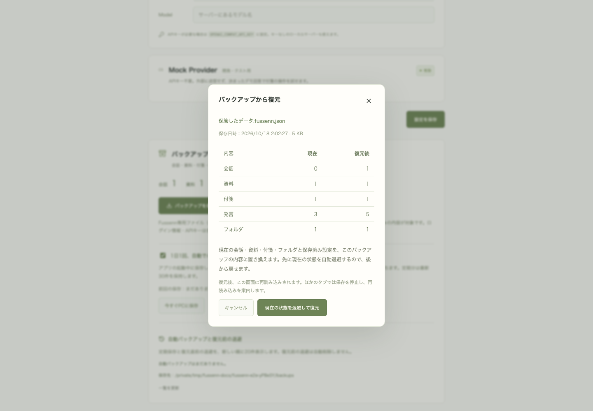

# バックアップと復元

設定画面で全データの保存・復元と、復元前の自動退避一覧を利用できる。対象は会話、取り込んだ資料の原文、全付箋と付箋内の発言、作成時Snapshot、アンカー、色、配置、折りたたみ・収納状態、曲線調整、フォルダ、DBへ保存済みの設定。バックアップを選ぶと日時と現在／復元後の件数を表示し、確認ボタンを押した場合だけ置き換える。

## ファイルと復元処理

現在はPDF資料と原稿編集を含むバージョン3の `.fussenn.json`（形式名 `fussenn-backup`）を出力し、バージョン1・2も読み込める。手動書き出しの名前は `Fussenn-<日時>.fussenn.json`。名称変更前の `.sidenote.json`（形式名 `sidenote-backup`）も復元できる。PDF資料には抽出した本文・ページ番号・付箋を含み、元PDFのバイナリは含まない。原稿案・原稿の全履歴・以前のAI参照Snapshotを含む追加仕様は [原稿編集](manuscript.md) と [PDFの取り込み](pdf-import.md) を参照。バージョン1・2のみ対応する版ではバージョン3を復元できない。

最初の実装（旧名称SideNote AI、2026-09-14）では、`src/server/services/backup-format.ts` がバージョン1の `.sidenote.json` を定義していた。形式識別子、バージョン、作成日時、8テーブル分の明示的な列、内容のSHA-256チェックサムを含む形式だった。現在もUTF-8とJSON、フィールドの型・範囲、IDの一意性、外部キー、付箋の元本文とSnapshotの所属、資料の読み取り専用構造を検証する。チェックサムは破損の検出用で、発行者の署名ではない。任意のSQLiteファイルやSQLは読み込まない。

上限は64MiB。リクエストの本文をストリームで数え、上限を超えたら読み込みを中断する。プレビューでファイル全体のダイジェストを返し、復元時は `X-Fussenn-Backup-Digest` ヘッダーで同じファイルか検証する。読み込めない形式や整合性の壊れたファイルでは、データを変更せず自動退避も作らない。

`src/server/services/backups.ts` は、SQLiteのIMMEDIATEトランザクション内で現在の状態を取得し、データディレクトリの `backups` に排他的な新規ファイルを作成して書き込み・fsyncを完了する。その後に保存データを置き換える。退避失敗時は置き換えに進まず、INSERT等の失敗時はトランザクション全体をロールバックする。復元に失敗した場合も完成した退避ファイルは残る。

自動退避ファイルは日時とUUIDから名付け、新しく作るファイルは `.fussenn.json` とする。ダウンロードと同じ確認画面を経た復元に対応する。ファイル名を検証し、対象ディレクトリの通常ファイルだけを扱う。名称変更前の `.sidenote.json` も、自動バックアップの一覧・復元・保持数管理の対象になる。復元前の退避は古いものも自動削除しない。追加した定期保存と30件の保持、両種類を合わせた最新20件の表示は [日常利用の仕上げ](daily-use.md) を参照。保存済みの件数表示は本文やSnapshotを読み込まずSQLのCOUNTで取得する。

ProviderのセッションIDは書き出さず、復元時にNULLへ戻す。復元後のAI質問は保存済みの履歴から新しいThreadを作り、復元時点より後のProvider側の履歴を再開しない。OAuth情報とAPIキーは対象外で、現在の認証情報を変更しない。未送信の質問、保存前の下書き、localStorageにある表示設定も対象外。

## 復元と別タブの編集

DB version 7で `workspace_metadata` に復元世代を追加し、既存8テーブルを変更せず移行する。各APIレスポンスが `X-Fussenn-Revision` を返し、書き込み時は同じ値を必須とする。復元のコミット時だけ値が変わる。本文の受信後にも照合するため、復元前に始まって復元後に到着した古い書き込みを拒否できる。

ブラウザはAPI呼び出しを `workspaceFetch` に集約する。別世代のレスポンスや別タブの復元通知を受けると保存を停止し、必要な下書きをコピーした後に再読み込みする案内を表示する。古い画面が新しい世代を自動採用して書き込むことはない。復元を実行したタブは正常応答を受けて再読み込みし、復元完了と自動退避の案内を表示する。

生成中は、進行中の処理とDB上のstreaming状態の両方を確認して保存・復元を409で拒否する。復元確認中のキャンセルは無変更で終了する。処理中の重複実行・Escによる閉じる操作を防ぎ、失敗時は選択したファイルを保持して再試行できる。

## 検証（2026-09-14）

以下は旧名称SideNote AIのときの検証記録。テスト件数と結果は当時のまま記載する。

Vitestでは全内容の往復、退避から戻す操作、Providerセッションの解除、壊れた形式・参照・Snapshotの拒否、退避先が書き込めない場合、削除後のINSERT失敗と全行のロールバック、生成中の拒否、64MiB超のストリーム中断、v6からのデータ保持、再起動後の復元世代維持を検証した。遅れて到着した本文による古い書き込みの拒否も確認した。

Playwrightでは実ダウンロード、プレビューとキャンセル、全データの復元、退避ファイルの実ダウンロードと復元、色・収納・曲線調整・資料の紐づき、別タブの下書き保持と保存拒否、再読み込み後の編集再開、不正ファイル、復元失敗と再試行、生成中と外部Originの拒否を確認した。通常の利用データと分離した一時DBを使用する。

`npm run check`（lint・型検査・59テスト・本番ビルド）とPlaywright全31シナリオが成功。稼働中のDBをSQLiteのbackup APIで退避してアプリを再起動し、v7への移行前後で既存8テーブル全行のハッシュ一致を確認した。会話2件・資料1件・付箋8件・発言7件・フォルダ1件とChatGPTのログイン状態を保持している。実データは書き出しとプレビュー検証だけを行い、復元による置き換えは行っていない。
