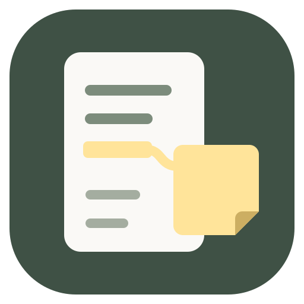

# アプリアイコンと製品情報

Fussennのアイコンは、本文のマーカーと右側の付箋を曲線で結んだオリジナルの図形です。既存の画面に合わせた深緑の地に、白い原稿と黄色い付箋を置いています。文字や外部のフォント・画像素材は使っていません。FussennのMITライセンスに含みます。



## 元データと再生成

編集する元データは [fussenn.svg](../public/brand/fussenn.svg) です。名称変更ではファイル名だけを変更し、図柄と再生成後のバイト列は同一です。

| 色 | 用途 |
| --- | --- |
| `#3F5145` | 深緑のアプリ背景 |
| `#FAF9F6` | 本文の紙 |
| `#FFE49A` | マーカー・引き出し線・付箋 |
| `#CCAE62` | 付箋の折り返し |
| `#7C8C7C`・`#A4ADA0` | 本文の行 |

```sh
npm run icons:generate
npm run icons:check
```

生成には開発用のSharpを使います。既存の固定版を開発依存としても明示しており、配布アプリへSharpを入れる変更ではありません。通常のビルドはコミット済み画像を使い、元SVG・生成スクリプト・出力ファイルのSHA-256を検査します。別OSで画像処理ライブラリの出力がわずかに変わっても、勝手に画像を作り直すことはありません。

- Windows ICO（`desktop/icons/fussenn.ico`）: 16・20・24・32・40・48・64・128・256pxの9サイズ。
- Mac ICNS（`desktop/icons/fussenn.icns`）: 16〜1024pxとRetina用表現。Dockでの余白を考慮して図形を少し内側に配置。
- デスクトップPNG（`desktop/icons/fussenn.png`）: 512px。
- ブラウザ（`public/brand/`）: 元SVG `fussenn.svg`、`favicon.ico`、32pxの `fussenn-32.png`、180pxのApple touch icon `fussenn-180.png`。

サイドバーと設定画面は同じSVGを参照します。デスクトップのウィンドウと「Fussennについて」、Windows実行ファイル・インストーラー・アンインストーラーにも同じ図形を設定しています。MacのパッケージにはICNS、開発起動時のDockにはPNGを指定しています。旧名称SideNote AIのときにApple Silicon Macで実機確認を行い、Aboutの名前・版・アイコンを確認しました。確認範囲と残る項目は [Macの検証記録](mac-validation.md) を参照してください。

## Windowsの製品情報

製品名・作者・説明・バージョンは `package.json` を元に配布用メタデータへ転記します。製品名は `Fussenn`、package名は `fussenn`、作者はMIT表記と同じ `Fussenn contributors` です。アプリIDは `app.fussenn.desktop`、ライセンス画面の表題は「Fussenn — ライセンス」です。

`win.signExecutable: false` により署名だけを省略し、アイコンと製品情報の書き込みを有効にしています。`signAndEditExecutable: false` に戻すと製品情報も省略されるので、代用しないでください。

パッケージ生成後のEXEとNSISインストーラーを読み取り、製品名・作者・著作権表示・数値バージョンと、埋め込まれた9サイズの画像データを検査します。準備後に名前・バージョン・アイコンが変わった場合も、再度 `desktop:prepare` を行うまでパッケージ生成を停止します。
