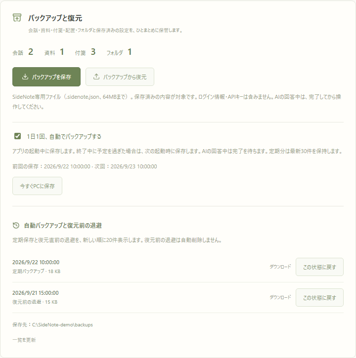
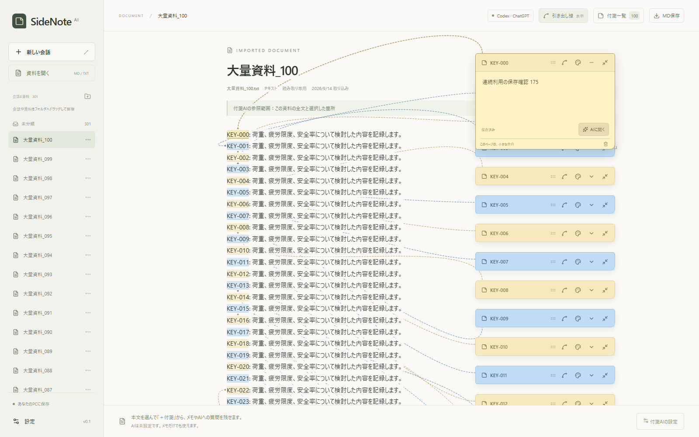

# 日常利用の起動・バックアップ・復旧（2026-09-14）

旧名称SideNote AIのときの実装・検証記録です。当時の名称と結果を残しています。現行の手順は [デスクトップ版](desktop.md) と [バックアップと復元](backup-restore.md) を参照してください。

## Windowsの起動と終了

`scripts/windows/Install-Shortcuts.ps1` がデスクトップに起動・終了のショートカットを作成する。作業フォルダとスクリプトの絶対パスを設定し、PowerShellを非表示で実行する。`npm run desktop:install` から再作成できる。無関係な同名ショートカットは上書きしない。

起動は同じ作業フォルダ・ポートの名前付きMutexで直列化し、二重クリックによる複数サーバーの起動を防ぐ。既存サーバーは `/api/health` のアプリ識別子と作業フォルダのハッシュを照合する。別アプリがポートを使っている場合は、そのプロセスを終了せず起動を見送る。Node.jsと依存関係を確認し、本番ビルドがなければ作成する。準備完了後に既定のブラウザを開く。

終了用スクリプトは、記録したPID、プロセス開始時刻、作業フォルダ、起動コマンドを照合し、AIの生成状態を確認してから自身のサーバーと子プロセスを終了する。PIDが再利用されていた場合や別のサーバーは停止しない。生成中は完了を待って再操作するよう案内する。保存済みDBを削除する処理はない。

起動ログ、エラーログ、プロセス記録は作業フォルダの `.tmp` に保存する。起動スクリプトはNode.js 22.13以上とインストール済み依存関係を前提とする。Windows以外では従来の `npm start` を使用する。

## 定期自動バックアップ

DB version 8で `backup_schedule` を追加する。定期保存は初期状態で有効。最後の成功から24時間ごとに実行し、アプリ終了中に予定を過ぎた場合は次回起動時に実行する。起動後5秒で初回確認し、以後1分ごとに期限を確認する。保存中のタイマーはプロセス終了を妨げない。

AIの生成中は次の確認まで見送り、保存エラーは記録して5分間隔で再試行する。画面に前回・次回の日時、保存エラー、有効／無効の設定、今すぐPCへ保存する操作を追加した。表示を更新するには「一覧を更新」を使用する。

既存の専用バックアップ形式を共用する。作成中は `.partial` を使い、書き込みとfsyncを完了してから履歴に表示されるファイル名へ変更する。定期分は新しい保存の成功後に最新30件を残す。復元直前の自動退避、無関係なファイル、作成途中のファイルは定期保存の整理対象にしない。設定画面は両種類を新しい順に最大20件表示し、どちらからも復元・ダウンロードできる。

定期保存の設定と実行履歴はPC側の運用状態として保持する。会話バックアップへ含めず、復元による置き換えからも除外する。通常の会話・付箋・資料テーブルとOAuth情報は変更しない。

## 復旧と負荷の検証範囲

定期保存の期限、終了期間を挟んだ次回起動、有効／無効の保持、回答中の見送り、書き込み失敗からの再試行、30件の保持と退避ファイルの保全を自動テストで検証した。日付を進めるテストでは34日分の保存を模擬している。

模擬App Serverを使い、回答途中の接続切断、認証切れ、Provider内の再試行、ブラウザ側のストリームキャンセルを再現した。途中の回答の保存、生成ロックの解除、次の質問での再接続、サインインし直した後の続行、認証操作によるデータ保持を確認している。生のProviderエラーやアカウント情報を画面へ出さないことも検証した。実際の認証トークンの期限が切れるまで待った更新動作は、この検証には含めていない。

起動・終了のテストでは二重起動、起動中の再実行、回答中の終了拒否、正常終了、再起動とデータ保持、古いプロセス記録の拒否、別アプリのポート占有を確認する。Windows子プロセスが出力パイプを保持する場合に備え、検証用ヘルパーはPowerShellプロセスの終了を基準に待機を解除する。

負荷検証は専用DBの会話200件、資料101件、付箋1,300件、発言1,701件を使用する。1資料の付箋100件と引き出し線を表示し、資料切り替え、付箋一覧と検索、メモ保存を10分間繰り返す。バックアップの往復、実際の定期タイマー、再起動後の保存データ一致、ブラウザのエラーとGC後のメモリ使用量も確認する。測定値は `.tmp/operations-report.json` に保存する。通常の利用データは使わず、外部AIの利用枠も消費しない。

今回の測定では176回の操作サイクルが完了し、画面エラーは0件、再起動前後の全保存データが一致した。

| 測定項目 | 結果 |
| --- | --- |
| バックアップサイズ | 約14.6MiB |
| バックアップの作成 | 266ms |
| バックアップの復元 | 900ms |
| 初期表示（付箋100件の資料） | 767ms |
| 資料APIの読み込み・95パーセンタイル | 136ms |
| 切り替え→検索→付箋を開く→メモ保存の一連の操作・95パーセンタイル | 3.50秒 |
| GC後のブラウザJSヒープ | 12.7MiB → 13.5MiB |

操作時間には複数のブラウザ操作と自動保存の待ち時間を含む。検証に使用したWindows環境・テストデータ・約10分の範囲での測定であり、数日連続の稼働や任意の巨大資料の性能を保証するものではない。

lint・型検査・本番ビルドが成功。通常のVitestは67件成功、Playwrightは全体実行の31件と、非同期チェックボックスの操作待ちを修正した1件の再実行が成功した（計32項目を確認）。Windows起動・終了と連続利用の運用テストは3件すべて成功し、専用サーバー3260・3270を終了した。

## 通常版への反映

実装前の状態をGitの `6a1004f` に保存し、認証情報・DB・バックアップ・実行ログをGitの対象から除外した。利用中のDBをSQLiteのbackup APIで保全してからv8へ移行し、既存8テーブルの全行のハッシュ一致を確認した。通常版でも定期バックアップが実際に作成され、エラーなしで次回日時が記録された。ChatGPTのログイン状態を保持している。

デスクトップの起動・終了アイコンを作成し、対象スクリプトと作業フォルダの設定を確認した。検証環境の自動承認審査により、こちらからショートカットを起動する操作は「ポリシーによるブロック」として拒否された。ブラウザを開かない起動・終了とサーバーの稼働確認は実施している。利用者は作成済みの「SideNote AI」アイコンから開ける。
