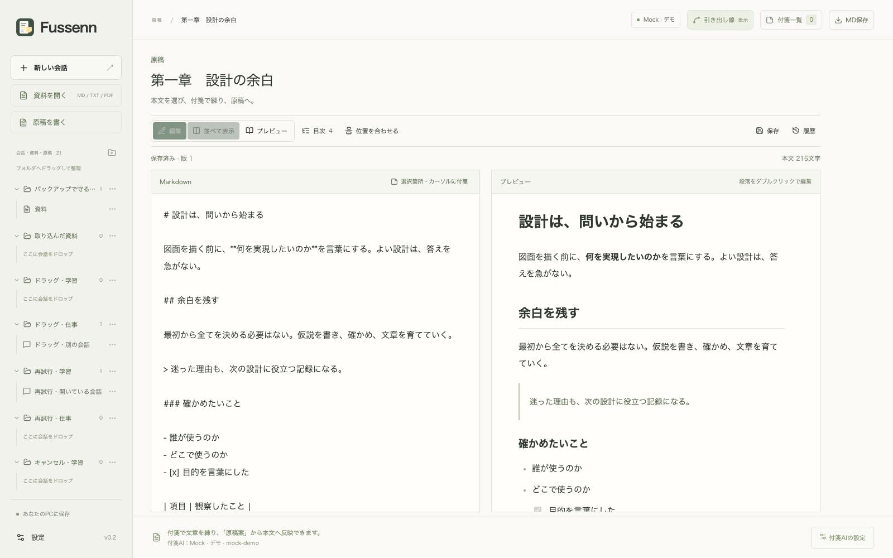

# 原稿のプレビュー（v0.2.4）

原稿上部で「編集」「並べて表示」「プレビュー」を切り替えます。「並べて表示」ではMarkdownの編集欄と整形した本文を同時に確認できます。表示幅が狭い場合は上下に並びます。最後に選んだ表示方法は、このアプリ・ブラウザ内で原稿共通の設定として記憶します。

見出し、強調、箇条書き、チェックリスト、引用、表、コード、脚注を整形します。脚注リンクと戻りリンク、見出しへのリンクはプレビュー内を移動します。編集中の内容をそのまま表示するので、自動保存を待つ必要はありません。保存に失敗した場合も、プレビューには手元の編集内容が表示されます。「保存済み」「未保存」は別に確認してください。画像は既存の資料表示と同様に説明文だけを表示し、外部から取得しません。

表示を切り替えても編集欄を作り直さないため、入力内容と取り消し・やり直しの履歴を保持します。日本語変換の途中は表示切り替えを見送り、確定を案内します。プレビューの段落をダブルクリックすると、その段落の先頭にカーソルを置いて編集画面へ戻れます。「位置を合わせる」は編集カーソルのある箇所をプレビューに表示します。各欄は独立してスクロールできます。

「目次」から見出しへ移動できます。`#` 形式と下線形式の見出しに対応し、コードブロック内の見出し記号は除外します。同名の見出しも、原稿内の位置で区別します。本文文字数はMarkdownの記号・リンク先・空白・改行を除いて数えます。編集欄で選択した文字数は、Markdown記号を含む選択範囲の文字数です。絵文字のサロゲートペアは1文字として数えます。

新しい付箋は編集欄から作成します。プレビューでは既存の付箋のマーカーと引き出し線も表示し、マーカーにしまった付箋を開けます。並列表示中のマーカーは編集欄側に表示します。原稿案の反映や過去版の復元後は、プレビューも新しい本文を表示します。

## 保存と実装

Markdownが引き続き原稿の正本です。プレビュー用のHTMLは保存せず、AIへ渡す本文やMD書き出しの形式も変更しません。DB v10・バックアップv3の変更はありません。表示方法の設定はlocalStorageに保存し、完全バックアップには含めません。

名称変更時、デスクトップ版は独自URLが `fussenn://app/` へ変わり、画面状態の保存場所も変わるため、原稿の表示方法が一度だけ初期値に戻ります。ブラウザ版は旧キーから引き継ぎます。

既存の色（紙面 `#faf9f6`、編集面 `#fffefa`、文字 `#303731`、操作の緑 `#435e47`、区切り `#dce2d6`）を使い、和文の書体を維持します。編集と閲覧を対面させ、見出しの階層・行間・余白で本文を読みやすくします。付箋を開いたときは右側の余白を確保します。

[react-markdown](https://github.com/remarkjs/react-markdown) と既存のGFM設定で整形し、Markdown ASTの位置情報を各要素に付けます。繰り返し現れる文章を文字列検索で特定しません。エスケープや文字参照で原文と表示文字数が一致しない場合、既存付箋のマーカーは対応するテキスト要素全体を示します。コードや空の挿入位置は対応ブロックの端に印を表示します。プレビューから本文を書き換える操作は、編集画面へ戻る操作だけです。

## 検証

Markdown構造・文字数、長文の目次と重複見出し、編集とプレビュー間の移動、未保存本文の表示、取り消し履歴、AI原稿案の反映、過去版の復元、日本語変換、画面幅1024pxでの配置をテストします。配布版では表示の切り替え、終了直前の本文保存、再起動後の本文と表示方法の保持を確認します。テスト用の原稿は専用の保存先を使います。
