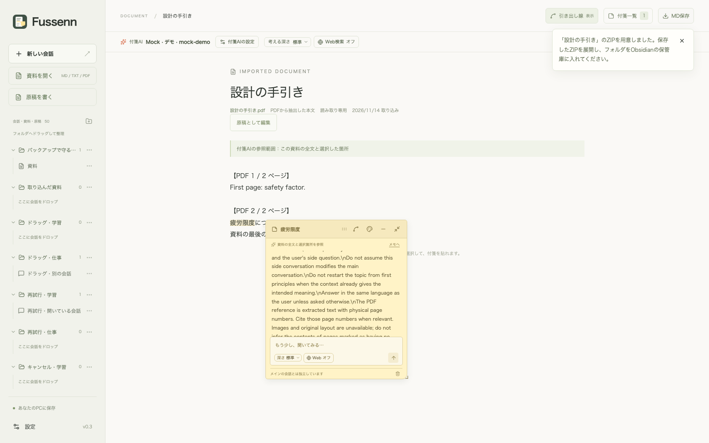

# PDFを資料として取り込む（v0.2.3）

「資料を開く」から `.pdf` を選ぶか、取り込み画面へドロップします。抽出した本文の冒頭、ページ数、文字を抽出できなかったページを確認し、「資料を取り込む」で保存します。解析中はページごとの進捗を表示し、キャンセルできます。

文字を選択できるPDFに対応します。10MB・200ページ以内、抽出した本文とページ番号の合計で10万文字以内です。パスワード付きPDF、画像だけのPDFは取り込まず、理由を表示します。OCRは今回の機能に含みません。一部のページに文字がない場合は、そのページの位置に注記を残し、取り込み前にもページ番号を表示します。白紙ページでも同じ注記になります。

PDF本体・画像・元のレイアウトは保存せず、抽出した本文と元ファイル名をFussennに保存します。本文に付く「PDF N / M ページ」はPDF内のページ順であり、紙面に印刷されたページ番号やローマ数字のラベルとは異なる場合があります。段組み・表・縦書き・特殊なフォントでは順序や文字の抽出が正確でないことがあります。

取り込んだ本文に付箋を付けてAIに質問できます。AIはページ番号を含む全文と選択箇所を参照します。画像や抽出できないページの内容は参照できません。「原稿として編集」で独立した原稿にコピーでき、MD書き出しでもページ番号を保持します。元のPDFを移動・削除しても、保存済みの本文と付箋は残ります。

## 実装と保存

[Mozilla PDF.js](https://mozilla.github.io/pdf.js/) 6.5.438を画面側のWorkerで使い、`getTextContent` で各ページの本文を抽出します。PDFのバイナリはサーバーや外部サービスへ送らず、保存操作で抽出済みの本文だけをFussennのローカルサーバーへ渡します。取り込み操作だけではAIへ送信しません。参考：[PDF.jsのAPI](https://mozilla.github.io/pdf.js/api/draft/module-pdfjsLib.html)。

Worker・日本語などのCMap・標準フォント・ライセンスを `scripts/pdf-assets.mjs` で `public/pdfjs` に配置します。`npm run dev` と `npm run build` 時に実行し、デスクトップにも同梱します。CDNからの取得は不要です。抽出ではPDFの画像を描画せず、WasmとフォントのDOM埋め込みを無効にしています。解析は60秒で中止し、ファイルの分割を案内します。

DB v10で `document_sources` の形式に `pdf` を加えます。既存の資料・原稿の全列をトランザクション内でコピーして制約を更新します。本文・付箋・原稿履歴の表は変更しません。PDFの形式を含むバックアップはv3の `.fussenn.json` で書き出し、名称変更前の `.sidenote.json` とv1・v2の読み込みも維持します。v1・v2のみ対応する版ではv3のバックアップを復元できません。形式と互換対応は [バックアップと復元](backup-restore.md) を参照してください。

## 検証

自作の小さなPDFを使い、日本語・ToUnicode・外部CMap・複数ページ・文字のないページ・パスワード保護・壊れたPDF・ページ数とファイルサイズの上限・解析キャンセルを確認します。利用者のPDFや保存データへテスト用の文章は追加しません。
