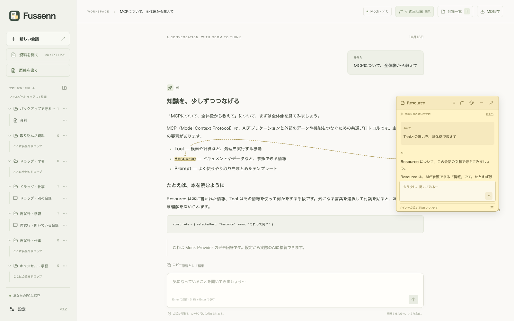

# Fussennの使い方

**理解を、余白に。** AIの回答から文章を選び、その場所に文脈付きの付箋を貼る、ローカルで動くデスクトップ向けチャットです。

付箋はメモとして使え、そのままAIに補足質問できます。付箋内の会話はメイン会話に混ざりません。



## 専用アプリで使う

Fussenn専用のウィンドウで操作するデスクトップ版があります。会話・資料・付箋は新規では `~/.fussenn` に保存し、名称変更前の保存先もそのまま利用できます。詳しくは [保存場所とプライバシー](#保存場所とプライバシー) を参照してください。

- **Windows**：自分でビルドした `Fussenn-win-x64.exe` でインストールし、**Fussenn** から起動します。
- **Mac**：Apple Silicon / Intelそれぞれの `.app`・DMG・ZIPを作る設定があります。Apple Siliconではビルド・配布版テスト・実機操作と、Developer IDによる署名・公証を確認済みです。Intel Macはビルドと配布版テストをGitHub ActionsとRosetta 2で確認済みで、画面を使った実機操作は未実施です。Intel版の署名・公証は、Intel版も配る場合に行います。詳しくは [Macの検証記録](mac-validation.md) を参照してください。
- **Linux**：AppImageを作る設定があります。GitHub Actions（Ubuntu 24.04）で、ビルドと展開したアプリでの配布版テストを確認済みです。AppImageからの起動と実機での確認は未実施です。
- 配布版には実行環境が同梱されるため、Node.js・npm・通常のブラウザは日常操作に不要です。ChatGPTログイン時は外部ブラウザを使います。Codex ProviderにはCodex CLIが別途必要です。
- ウィンドウを閉じると、メモを保存して内部サーバーも終了します。回答生成中・ダウンロード中・保存失敗時は終了を見送ります。

導入・ビルド手順、保存先、検証範囲は [デスクトップ版の説明](desktop.md) を参照してください。

## 原稿を執筆・推敲する

サイドバーの **原稿を書く** で原稿を作れます。取り込んだ資料やAI回答の **原稿として編集** から始めることもできます。本文を選んで付箋で推敲し、**原稿案 → 本文へ反映…** で置換・挿入します。差分を確認して採用でき、**履歴** から過去の原稿を復元できます。

**原稿を書く → ファイルから取り込む** では、手元の `.md`・`.markdown`・`.txt` から書き始められます。ファイル選択・ドラッグ＆ドロップに対応し、本文をFussenn内にコピーして保存します。UTF-8、1MB・10万文字以内です。

**編集・並べて表示・プレビュー**を切り替えて、Markdownを整形した本文を確認できます。目次から見出しへ移動し、プレビューの段落をダブルクリックして編集に戻れます。詳しくは [原稿のプレビュー](manuscript-preview.md) を参照してください。

反映後は **続けて推敲する** で同じ付箋を使い続けられます。AIは修正後の本文を参照し、次の原稿案を再び反映できます。

新しい付箋は保存した最新の本文を参照します。既存の付箋は参照した版を保持し、必要なときに **最新の本文で相談し直す** で更新できます。使い方・保存と復元の範囲は [原稿編集](manuscript.md) を参照してください。

## ブラウザ版・開発環境に必要なもの

- Node.js **22.13以上**。開発・実機確認にはNode.js 24を使用。
- npm
- Desktop Chrome / Edge、画面幅1024px以上。Safari / FirefoxはBest Effort。
- Codexを使う場合のみ、`codex app-server` が利用できるCodex CLIとChatGPTログイン。

Next.js / React / TypeScript、SQLite / Drizzle、OpenAI Node SDK、react-markdown、react-rnd、Zodを使用。Dockerや外部DBは不要です。

## インストールと起動

```sh
npm run setup
```

`.env.example` を `.env.local` にコピーします。

PowerShell:

```powershell
Copy-Item .env.example .env.local
```

macOS / Linux:

```sh
cp .env.example .env.local
```

**まず操作だけ試す場合**は、`.env.local` を以下のように変更してください。

```dotenv
ENABLE_MOCK_PROVIDER=true
```

```sh
npm run dev
```

[http://127.0.0.1:3000](http://127.0.0.1:3000) を開きます。Mockを選ぶと、実際のAIや認証情報を使わずに操作を試せます。

本番相当のローカル起動:

```sh
npm run build
npm start
```

サーバーは `127.0.0.1` で待ち受けます。別ポートでは `npm run dev -- --port 3001` と指定できます。

### 従来のブラウザ版をWindowsのデスクトップから起動する

一度だけ `npm run desktop:install` を実行すると、デスクトップに **Fussenn Browser** と **Fussenn Browser - Stop** を作成します。起動・停止には `scripts/windows/Launch-Fussenn.ps1`・`scripts/windows/Stop-Fussenn.ps1` を使います。同じ作業フォルダを指す旧 **SideNote AI**・**SideNote AI - Stop** ショートカットは、このとき削除します。

これはブラウザ版用です。専用アプリの **Fussenn** とは別の入口です。同じ保存先を使用するので、切り替える前に起動中のアプリ・ブラウザ版を終了してください。専用アプリが起動中のブラウザ版を検出すると、新旧の名前に応じて **Fussenn Browser - Stop** または **SideNote AI - Stop** を案内します。

- **Fussenn Browser** をダブルクリックすると、サーバーをバックグラウンドで起動して、準備ができてからブラウザを開きます。既に起動中なら、その画面を開きます。
- **Fussenn Browser - Stop** で終了します。保存済みデータは残ります。AIの回答中は終了を見送り、完了後に再度操作するよう案内します。
- Node.jsと `npm run setup` 済みの環境が必要です。本番ビルドがない場合は起動時に作成します。コードを更新した場合は、終了してから `npm run build` を実行してください。
- 起動失敗時のログは作業フォルダ内の `.tmp/desktop-3000.err.log`。別のアプリが同じポートを使っている場合は、そのアプリを終了せずエラーを表示します。
- 作業フォルダの位置を変えた場合は、元のショートカットを削除し、移動先で `npm run desktop:install` を再実行してください。

## 使い方

1. 新しい会話でProviderとモデルを選び、質問します。最初の送信から、この会話のProviderとモデルは固定されます。
2. 完了したAI回答の気になる文章を選択し、**＋付箋** をクリックします。
3. 付箋にメモを書くと自動保存されます。ヘッダーで移動、右下でサイズ変更できます。
4. **AIに聞く** でメモを質問として送信します。メモが空の場合は、選択した文章の文脈に沿った説明を求めます。
5. 付箋の中で追加質問できます。**メモへ** / **付箋の会話に戻る** で表示を切り替えられます。
6. ヘッダーの **−** で折りたたみ、**⌄** で開きます。付箋の削除は下部のゴミ箱です。
7. ヘッダーの **パレットアイコン** から、黄色・ピンク・ブルー・グリーン・ラベンダーを選べます。ハイライトと接続線も同じ色になり、選んだ色は自動保存されます。
8. さらに小さくしたい場合は、ヘッダー右端の **内向きの矢印（マーカーにしまう）** を押します。付箋と接続線が消え、本文のマーカーだけが残ります。マーカーをクリックすると元の位置・サイズで付箋を開きます。

マーカーにしまった状態も保存されます。付箋のメモ・AIの回答・入力途中の質問は、同じ画面で出し入れしても保持されます。回答の生成はしまったまま続きます。マーカー上の文字も通常どおり選択でき、Tabでマーカーへ移動してEnter / Spaceで開くこともできます。重なったマーカーをクリックした場合は、対応する付箋をまとめて開きます。元の文章を見つけられない場合は、会話内に取り出すためのボタンを表示します。

文章は一つのAI回答内で、最大500文字まで選択できます。生成中の回答やユーザーのメッセージには付箋を作れません。座標は会話Canvasを基準とし、ページと一緒にスクロールします。

引き出し線は滑らかな曲線で、付箋の位置に合わせてマーカーと付箋の上・下・左・右から接続する辺を自動で選びます。付箋ヘッダーの **曲線アイコン（引き出し線を調整）** を押すと、線そのものや中央の丸い点をドラッグしてカーブを変えられます。両端の丸い点を動かすと、マーカーや付箋の辺に沿って接続位置を変更できます。

**表示中の付箋の引き出し線は、選択していなくても常に表示します。** それぞれの付箋と同じ色になり、選択した付箋の線は少し太くなります。右上の **引き出し線** ボタンで、すべての線をまとめて非表示・再表示できます。表示状態はこのブラウザに保存し、会話の切り替えや再読み込み後も引き継ぎます。非表示中に付箋の「引き出し線を調整」を押すと、線の表示を再開して調整できます。

名称変更後もブラウザ版では旧キーから画面の表示設定を引き継ぎます。デスクトップ版は独自URLが `fussenn://app/` に変わるため、引き出し線の表示切替と原稿の表示モードが一度だけ初期値に戻ります。会話や付箋の内容・配置は保持します。

調整は自動保存され、付箋の移動・サイズ変更・折りたたみに追従します。**自動に戻す** で調整を解除し、**完了** で通常の表示に戻ります。ドラッグ中のEscでその操作をキャンセルできます。丸い点にTabでフォーカスすると矢印キーでも調整でき、Shiftで大きく動きます。本文と交差する部分は文字の周囲だけ線を描画しません。マーカーにしまっている間は線を表示しません。

## 会話内の付箋を一覧で見る

右上の **付箋一覧** を押すと、開いている会話の付箋を作成順で確認できます。付箋の色、元の言葉、メモまたは付箋内の会話の抜粋、表示・折りたたみ・マーカー収納の状態を表示します。

- 検索欄で、元の言葉・メモ・付箋内の会話全体を検索できます。英字の大文字・小文字や全角・半角の違いを吸収し、空白で区切るとすべての語を含む付箋を探します。
- **しまった付箋** で、マーカーに収納した付箋だけに絞れます。
- 一覧の付箋を選ぶと、その付箋を手前に表示してスクロールします。収納・折りたたみ中なら開きます。元の位置・サイズ・内容・色・線の調整を保持します。
- 一覧は **×**、Esc、一覧外のクリックで閉じられます。キーボードでも検索・選択・移動できます。

一覧を開いても付箋のAI回答は生成を続けます。付箋の内容や追加・削除は一覧と件数へ反映され、別の会話の付箋は混ざりません。

## Obsidianへ書き出す

会話のほか、取り込んだ資料も同じ操作で書き出せます。資料のファイルには元のファイル名・形式と本文を残し、各付箋の「元の資料へ戻る」から参照元を開けます。

会話を開き、右上の **MD保存** を押すと、その会話とすべての付箋を相互リンク付きMarkdownのZIPとしてダウンロードできます。追加のログインやObsidianのプラグインは不要です。

1. ZIPを展開し、出てきた `Fussenn-<id>` フォルダを丸ごとObsidianの保管庫に入れます。保管庫内のサブフォルダでも構いません。ZIP名は `Fussenn-<タイトル>-<id>.zip` です。
2. **会話 - タイトル - … .md** を開きます。会話全文と付箋一覧、各発言に紐づいた付箋へのリンクがあります。
3. 付箋のファイルには、選択した原文・メモ・付箋内のAIとの会話を収録します。**元の発言へ戻る** から、元の会話の該当する発言に移動できます。

折りたたみ・マーカー収納中の付箋も含みます。メモは保存待ちの編集も含め、ボタンを押した時点の画面の内容を使います。生成中・中断された回答は、その状態を明記して収録します。送信していない質問は含みません。

ファイル名にはIDを付けるため、同じ言葉の付箋や同名の会話も区別できます。タイトル・作成日時・付箋の色などは先頭のプロパティにも残します。本文のMarkdownは保持し、[Obsidianの内部リンクとブロックリンク](https://help.obsidian.md/links)で会話と付箋をつなぎます。ブロックリンクの行き先は元の発言の先頭で、選択した文字列そのものは付箋側の引用で確認できます。

種類・IDのプロパティは `fussenn_type`・`fussenn_id`、発言のアンカーは `^fussenn-message-<id>` です。名称変更前の書き出しで使っていた `sidenote_type`・`sidenote_id` など、既存の書き出しは変更しません。

書き出しはブラウザ内で行います。付箋の位置・引き出し線の見た目、外部の画像や添付ファイルは同梱しません。書き出した付箋の再取り込みや自動同期はなく、繰り返し書き出した際のファイル整理はObsidian側で行います。

## Markdown・テキスト・PDF資料に付箋を付ける

左の **資料を開く** から、手元の `.md`・`.markdown`・`.txt`・`.pdf` を取り込めます。ファイルを選ぶか、取り込み画面へドロップし、内容の冒頭を確認して **資料を取り込む** を押してください。MD・TXTはUTF-8（BOM付きにも対応）で1MBまで。PDFは10MB・200ページまで。保存する本文はいずれも10万文字までです。

PDFは抽出した本文にページ番号を付けて保存します。画像やレイアウトの表示、OCR、パスワード付きPDFには対応していません。詳しくは [PDFの取り込み](pdf-import.md) を参照してください。

- Markdownは見出し・表・コードを整えて表示し、テキストは記号や改行を文字どおりに表示します。
- 本文の気になる箇所を選択して **＋付箋** を押すと、従来どおりメモ・色変更・移動・折りたたみ・マーカー収納・付箋一覧・引き出し線の調整が使えます。
- **AIに聞く** で資料の全文と選択した箇所、その付箋内の会話を参照します。他の資料や別の付箋の会話は含みません。取り込みやメモだけではAIへ送信しません。
- AIの初期値は取り込み時点のアプリ設定を使います。モデルが未設定でも読む・メモする操作は可能です。資料の右下にある **付箋AIの設定** で、Providerとモデルを選べます。回答の生成中は変更できません。
- 資料はサイドバーの書類アイコンで区別できます。フォルダへのドラッグ、表示タイトルの変更、削除も会話と同じ操作です。元のファイル名は別途保持します。

本文は取り込んだ時点のコピーとして読み取り専用で保存し、元ファイルを変更しません。同名のファイルをもう一度取り込むと別の資料になります。元ファイルとの同期、本文の編集、画像・添付ファイルの取り込みはありません。長い資料も全文をAIの参照範囲とし、対応できる量は選択したProvider・モデルによります。

## 会話を整理する

- サイドバーの **フォルダ＋アイコン** からフォルダを作成できます。
- **会話のタイトル部分をフォルダへドラッグ＆ドロップ** すると移動できます。移動先がハイライトされ、閉じたフォルダにも入れられます。保存後は移動先のフォルダが開きます。
- フォルダ間の移動も同じ操作です。**未分類** にドロップすると、フォルダから外せます。同じフォルダへのドロップは変更せず、ドラッグ中のEscでキャンセルできます。
- 会話の右端の **…** を押すと、**会話のタイトル** と **保存先フォルダ** を変更できます。フォルダから出す場合は「未分類」を選びます。
- フォルダ名のクリックで開閉、右端の **…** でフォルダ名の変更・削除ができます。フォルダを削除しても中の会話と付箋は残り、「未分類」に戻ります。
- 新しい会話は「未分類」に作成されます。手動で付けたタイトルは、その後の質問でも保持されます。会話自体の削除は会話の編集画面から行えます。

タイトルとフォルダ分けはローカルDBに記録され、再読み込み後も復元されます。ドラッグで整理しても開いている会話は切り替わらず、入力途中の文章や付箋の内容を保持します。保存に失敗した場合は元の場所に表示を残し、サイドバーの **再試行** からやり直せます。キーボードで移動する場合は、会話の **…** から保存先フォルダを選べます。

## Providerの設定

設定画面でデフォルトのProviderと各モデル名を保存できます。変更は新しい会話に適用されます。

### Codex + ChatGPT Login

Codex CLIを[公式のインストール手順](https://developers.openai.com/codex/cli)に沿って準備し、`codex --version` が実行できることを確認してください。

設定画面の **ChatGPTでサインイン** からブラウザで認証します。ブラウザで認証できない場合は **Device Codeを使う** を選び、表示されたページとコードを使用してください。既にCLIにログインしていれば、その認証を再利用します。

設定画面へ戻ったときと、画面を表示している間は定期的に認証状態を更新します。別の画面からログアウトした場合や、ログイン待ち中にページを再読み込みした場合も状態を確認し直します。入力途中の設定は保持します。

`CODEX_BIN` にCLIのパスを設定できます。初期値は `codex`。モデル一覧は `model/list` から取得し、モデル名はハードコードしていません。

ChatGPTログイン時の利用は、アカウントの **Codex subscription access / 利用枠** に従います。無制限の利用を意味しません。OpenAI APIのBYOKは別の接続方式です。

- App Serverのstdio / JSONLのみを使用し、experimental APIは有効化しません。
- Mainと各付箋に独立したThreadを作成します。
- Thread再開に失敗した場合、SQLiteの履歴と付箋のSnapshotから新しいThreadを再構成します。
- cwdはFussennのデータディレクトリ内の `codex-workspace/` です。
- read-only sandboxを指定し、Shell・既存MCP・Apps・multi-agent・Memories・hooks・Web Searchを無効化します。コマンド・ファイル変更の承認要求は拒否します。
- ログアウトすると共有しているCLI認証からもログアウトします。

詳細: [Codex App Server公式ドキュメント](https://developers.openai.com/codex/app-server)。開発時の実機確認はCodex CLI **0.144.4**。同CLIはreadable rootsを限定する新しい `access` フィールドに未対応のため、対応しているread-only設定とツール無効化を使っています。OSごとのsandbox実装はCLIに依存します。

### OpenAI BYOK

`.env.local` に設定し、サーバーを再起動します。

```dotenv
OPENAI_API_KEY=your-key-here
```

設定画面の **OpenAI Model** に使用するモデル名を指定します。OpenAI Node SDKのResponses APIを使用し、会話履歴を毎回SQLiteから構築して送信します。`store: false` を指定し、サーバー側Conversation IDには依存しません。

接続先は公式の `https://api.openai.com/v1` に固定しています。他のツール向けに環境変数 `OPENAI_BASE_URL` を設定していても使いません。別の接続先には、次のOpenAI Compatible APIを使ってください。

### OpenAI Compatible API

設定画面で **Base URL** と **Model** を指定します。例: `http://localhost:11434/v1`。モデル名は、接続先で実際に利用可能なものを入力してください。

APIキーが必要なサービスのみ、`.env.local` に以下を設定して再起動します。

```dotenv
OPENAI_COMPAT_API_KEY=your-key-here
```

キー不要のローカルサーバーにも対応し、キー未設定時はAuthorizationヘッダーを送りません。リクエストbodyは原則 `model` / `messages` / `stream` のみです。Chat CompletionsのSSEストリーミングと `finish_reason: stop` に対応したサーバーを使用してください。

### Mock Provider

`ENABLE_MOCK_PROVIDER=true` のときだけ選択できます。外部リクエストやAPI料金なしで、決まった日本語のデモ回答をストリーミングします。AI推論は行いません。テスト用に `[context]` と送信すると、その生成に渡された入力を返します。

## 保存場所とプライバシー

新規の標準保存先は **`~/.fussenn/fussenn.db`** です。Windowsでは通常 `%USERPROFILE%\.fussenn\fussenn.db`。`FUSSENN_DATA_DIR` でディレクトリを変更できます。旧名の `SIDENOTE_DATA_DIR` も利用でき、両方を指定した場合は新名を優先します。

`~/.fussenn` がなく、名称変更前の `~/.sidenote-ai` がある場合は、旧フォルダを移動せずそのまま使います。使用するフォルダ内に `fussenn.db` がなく `sidenote.db` があれば、そのDBを使います。両方のフォルダがある場合は `~/.fussenn` を使い、旧フォルダには触れません。

保存先の名前も変える場合は、`~/.fussenn` がまだないことを確認し、アプリとブラウザ版を終了してから `~/.sidenote-ai` を `~/.fussenn` に名前変更してください。コピーではなく移動し、中の `sidenote.db` はそのままで構いません。すでに両方のフォルダがある場合は、上書きせず、使うデータを確認してください。

- 会話、付箋、付箋内の会話、作成時Snapshot、座標をSQLiteに保存します。
- 座標は意味的な付箋データと別テーブルです。
- 付箋のSnapshotは**付箋を作った瞬間**にサーバー側で固定され、後から自動更新されません。
- MainのContext Builderはメインの `messages` テーブルだけを読み、付箋テーブルを参照しません。
- APIキーは環境変数のみ。APIレスポンスやDBには含めません。OAuthトークンの保存・更新はCodexが管理します。
- Codexは自身の管理ディレクトリにも認証情報・Thread履歴を保持します。Fussennの正本はSQLiteです。
- 独自のアカウント、クラウドDB、同期、共有、Analyticsはありません。Next.jsのTelemetryも起動スクリプトで無効化しています。
- AIへの質問時は必要な会話文脈を選択したProviderに送信します。Provider側のデータの取り扱いは各サービスの条件に従います。
- MarkdownのRaw HTML、外部画像を表示せず、APIではHostとOriginを検証します。
- SQLiteは暗号化していません。PCのアカウントとファイルアクセス権で保護してください。

## バックアップと復元

[設定画面](http://127.0.0.1:3000/settings) の **バックアップと復元** から操作します。

1. **バックアップを保存** で、全会話・取り込んだ資料の本文・付箋と付箋内の会話・作成時Snapshot・色と配置・曲線調整・フォルダ・保存済み設定を、1つの `Fussenn-<日時>.fussenn.json` ファイルへ保存します。
2. **バックアップから復元** でファイルを選ぶと、保存日時と現在／復元後の件数を確認できます。ここではデータを変更せず、キャンセルできます。名称変更前の `.sidenote.json` も復元できます。
3. **現在の状態を退避して復元** で、現在の全データと保存済み設定を置き換えます。先に現在の状態を自動退避し、退避に失敗した場合は復元しません。復元中のエラーでも元のデータを保持します。
4. 戻したい場合は **自動バックアップと復元前の退避 → この状態に戻す** を選びます。退避ファイルのダウンロードにも対応しています。

**定期自動バックアップは初期状態で有効**です。アプリの起動中に24時間ごとに保存し、終了中に予定を過ぎた場合は次回起動時に保存します。AIの回答中は完了を待ち、保存に失敗した場合は5分後から再試行します。設定画面で有効／無効、前回・次回の日時、保存エラーを確認でき、**今すぐPCに保存** でその場で保存することもできます。

自動保存先は使用中のデータディレクトリ内の `backups` です。Windowsで新規の標準保存先を使う場合は `%USERPROFILE%\.fussenn\backups`、旧フォルダを引き継いだ場合は `%USERPROFILE%\.sidenote-ai\backups` になります。`FUSSENN_DATA_DIR`（または旧名の `SIDENOTE_DATA_DIR`）を指定した場合はその配下です。新しく作るファイルは `.fussenn.json` で、旧 `.sidenote.json` も一覧と保持数の管理に含めます。画面に最新20件を表示します。**定期分は最新30件を保持**し、新しい保存が成功してから古い定期ファイルを整理します。**復元直前の退避は自動削除しません**。PC自体の故障に備える場合は、保存したファイルを別の保存先にも保管してください。定期保存の有効／無効と実行履歴は、そのPCの運用設定として保持し、会話データの復元では変更しません。

対応サイズは64MBまで。AIの回答中は、完了してから保存・復元してください。バックアップにはDBに保存済みの内容を含み、未送信の質問・保存前の下書き・ブラウザの表示設定（引き出し線の一括表示など）は含みません。APIキー・OAuthのログイン情報・CodexのThread IDも含みません。別PCではAIの接続を別途設定し、復元後のAI質問は保存済みの会話から新しいThreadで続けます。

復元後は画面を再読み込みします。ほかのタブは保存を停止して再読み込みを案内するため、必要な下書きはコピーしてから再読み込みしてください。Obsidian用のMD保存は閲覧・活用のための書き出しで、Fussennへ状態を戻す場合はこちらの専用バックアップを使います。

手動でデータディレクトリをコピーする場合は、アプリを停止してディレクトリ全体をコピーしてください。起動中に `.db` だけをコピーすると、WAL内の変更が含まれないことがあります。

## 開発とテスト

```sh
npm run lint
npm run typecheck
npm test
npm run build
```

まとめて実行する場合は `npm run check`。

E2E:

```sh
npx playwright install chromium
npm run build
npm run test:e2e
```

E2Eはポート3100の本番ビルド、Mock、OSの一時ディレクトリに作る専用SQLiteを使用します。普段のユーザーデータには触れません。失敗時の画像・トレースは `test-results/` と `playwright-report/` に保存されます。

Windowsの起動・終了、大量データと10分間の連続操作は `npm run build` の後に `npm run test:operations` で確認できます。ポート3260〜3272と専用の一時DBを使用し、通常の会話や認証情報には触れません。負荷測定の結果は `.tmp/operations-report.json`。実行中は本番ビルドを書き換えないでください。認証切れと接続切断からの復帰は、通常の `npm test` 内で模擬App Serverを使って検証します。

APIを直接呼ぶ場合は、`GET /api/workspace` で返る `X-Fussenn-Revision` ヘッダーを保持し、POST / PATCH / DELETEに同じ値を付けてください。復元で値が変わり、古い値の書き込みは409になります。409時は最新データを読み直して操作内容を確認します。通常の編集では値は変わりません。

実際のCodexとの疎通を確認する任意のテスト:

```sh
npm run test:codex
```

既存のChatGPTログインが必要で、**Codex利用枠を消費します**。メインと付箋の生成、独立Thread、Thread再開、SQLite保存を検証します。通常の `npm test` / E2Eは外部AIに接続しません。

主なコード:

| 機能 | 場所 |
| --- | --- |
| Rendered Textの選択・復元 | `src/lib/anchor/` |
| Main Context | `src/lib/context/main.ts` |
| SideNote Context | `src/lib/context/side-note.ts` |
| Floating Note / Canvas | `src/components/sidenote/` |
| SQLite / スキーマ・マイグレーション | `src/server/db/` |
| 保存・Snapshot・生成処理 | `src/server/services/` |
| AI Provider / Codex JSONL Client | `src/server/providers/` |
| 共有NDJSONストリーム | `src/lib/stream/`、`src/hooks/use-chat-stream.ts` |

## 現在の制限

- Desktopのみ。モバイル、添付、画像、音声、検索、クラウド同期、共有は対象外です。
- 会話の回答を直接書き換える機能はありません。「原稿として編集」でコピーして推敲します。資料・原稿の付箋AIは専用設定からProvider / Modelを変更できます。
- 同じMain / 同じ付箋での二重生成は拒否します。Mainと別の付箋は独立して生成できます。
- 長い会話の自動要約はありません。モデルのコンテキスト上限を超えた場合は新しい会話にしてください。
- 回答の生成は約3分を上限に中断します。失敗時は受信済みの文章を保存します。プロセスの強制終了時は最後の未保存ストリームが失われる可能性があります。
- 表示文面が変わりAnchorを一意に復元できなくなった場合も、付箋は残して警告します。
- 拡大表示を大きくして会話の表示領域が狭くなると、引き出し線の調整ツールバーが領域からはみ出したり、端点に重なったりすることがあります。その場合は表示倍率を戻して調整してください。
- ローカルでの個人利用向けです。サーバーをインターネットへ公開する構成にはしていません。
- Windowsで自動テストとCodex実機テスト、Apple Silicon Macで自動テストと配布版の実機操作を実施。Intel Mac・LinuxはGitHub Actionsで自動テストと配布版テストを実施しましたが、画面を使った実機確認は未実施です。
- OpenAI APIはSDKと模擬HTTPストリーム、CompatibleはローカルHTTPサーバーで検証。任意の外部サービス・モデルすべての互換性を保証するものではありません。

## License

[MIT](../LICENSE)。
